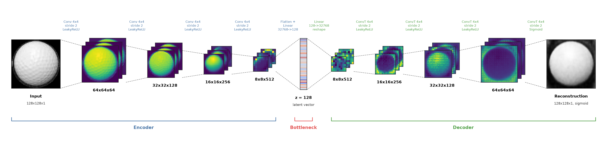
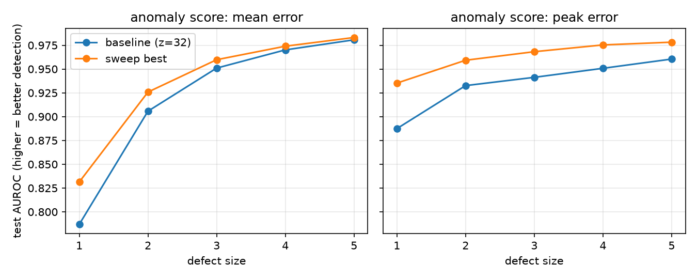

# CS541 Final Project Repository

## Group Members

- Neel Awsare
- Daniel Gwon
- Matthew Montero
- Onkar Sama

## Paper

- [Link to Paper Proposal](https://docs.google.com/document/d/1iLjUq3U7Ygea7iWgvsFbWedjgt0L40MWl2J0o4DOJvw/edit?usp=sharing)
- Link to paper (not available yet)

## [Data](data)

- [`data/raw`](data/raw) = imported sources
- [`data/cropped`](data/cropped) = generated by script (see below)
- [`scripts`](scripts) = command-line tools (`scripts/data/` data prep, `clean.py`, `train.py`, `evaluate.py`, `sweep.py`, `preview.py`), [`golfball`](golfball) = the shared package they import (paths, dataset, model, training engine, cleaning helpers), [`docs`](docs) = assignment PDF and LaTeX paper example

- [`data/raw/golf-ball-roboflow.ndjson`](data/raw/golf-ball-roboflow.ndjson) = 2188 images
  - Source: [golf ball Computer Vision Model | Roboflow](https://universe.roboflow.com/young-jin-park-6vhep/golf-ball-5sqna)
  - No images with defects.
  - Contains images in directory.
  - Imported as individual datasets of train/validation/test splits.
    - Original Import: [`data/raw/golf-ball-roboflow-original`](data/raw/golf-ball-roboflow-original)
  - Reformated as one dataset with train/validation/test splits in JSON
    - **IMPORTANT**: DO NOT DELETE ORIGINAL IMAGES. `data/raw/golf-ball-roboflow.ndjson` points to original imports.
- [`data/raw/golf-ball-detection.ndjson`](data/raw/golf-ball-detection.ndjson) = 989 images
  - Source: [Golf Ball Detection | Ultralytics](https://platform.ultralytics.com/xu-wen/datasets/golf-ball-detection)
  - No images with defects.
  - Imported as one dataset with train/validation/test splits in JSON.
  - Images downloaded by [`scripts/download_images.py`](scripts/download_images.py) into [`data/raw/golf-ball-detection-original`](data/raw/golf-ball-detection-original); `file` points there and the (expiring) `url` is kept.
- [`data/raw/golf-ball.ndjson`](data/raw/golf-ball.ndjson) = 60 images
  - Source: [golf ball | Ultralytics](https://platform.ultralytics.com/shark-heron/datasets/golf-ball)
  - Classes `New golf` / `old  golf`, but all images are normal balls (no defects).
  - Imported as one dataset with train/validation/test splits in JSON.
  - Images downloaded by [`scripts/download_images.py`](scripts/download_images.py) into [`data/raw/golf-ball-original`](data/raw/golf-ball-original); `file` points there and the (expiring) `url` is kept.

All three datasets contain only normal balls. The goal is an autoencoder trained on normal balls that fails to reconstruct damaged ones.

## Cropped Datasets

Generated by [`scripts/crop_dataset.py`](scripts/crop_dataset.py). Every image is **128×128** and contains one ball: each bounding box (images with several balls give several crops) is expanded to a square around its center (shifted to stay inside the image, so it includes some real background), cropped, converted to grayscale, resized with Lanczos, and everything outside a circle around the ball (diameter = mean of the box width and height) is set to black. Boxes under 32 px on their shorter side (in the original image) are skipped. Same NDJSON format; each record's box is that ball's position inside the square crop. Other balls that fall inside a crop are not labeled. Crop files are named `<original name>_<box index>.jpg`.

- [`data/cropped/golf-ball-roboflow.ndjson`](data/cropped/golf-ball-roboflow.ndjson) = 3286 crops
- [`data/cropped/golf-ball-detection.ndjson`](data/cropped/golf-ball-detection.ndjson) = 977 crops
- [`data/cropped/golf-ball.ndjson`](data/cropped/golf-ball.ndjson) = 57 crops
- Images are in the matching `data/cropped/<name>/<split>/` folders.
- [`golfball/dataset.py`](golfball/dataset.py) loads the cleaned crops in `data/cleaned_final` (see [`data/DATA_CLEANING.md`](data/DATA_CLEANING.md); rebuild with `uv run scripts/clean.py all`) for the autoencoder as `(image, mask)` pairs; compute the loss only inside the mask.

## Baseline Autoencoder

[`scripts/train.py`](scripts/train.py) trains the autoencoder defined in [`golfball/model.py`](golfball/model.py): convolutional autoencoder (4 strided-conv layers down to 8×8×256, linear bottleneck of size `z`, mirrored transposed-conv decoder, sigmoid output) trained on normal balls only (the baseline uses `z=32`; the figure below shows the larger sweep-best config). Loss is MSE over ball pixels (inside the mask), normalized by ball area. AdamW (no weight decay by default), lr 1e-3, early stopping on validation loss; the best model is saved to `checkpoints/ae_z<z>.pt` (gitignored).



Architecture of the sweep-best config (`configs/best.json`: `z=128`, base 64, no norm, LeakyReLU). The images are real activations (the three most varied channels per layer) of the trained `best.pt` on one test ball, so the figure shows what each stage keeps of the input and what the decoder rebuilds.

```bash
uv run scripts/train.py --config configs/baseline.json   # z=32, 50 epochs, patience 5
```

`train.py` also takes `--base --norm --act --loss --lr --weight-decay --batch-size --no-augment --cosine --out` (the sweep's parameters) and `--config <json>` to retrain a saved config.

**Evaluation.** No real damaged balls exist yet, so the test set is the normal test balls vs. the same balls with synthetic scratches/scuffs (`Defective` in `golfball/dataset.py`: scratches, cracks, gouges, scuff patches and broken-off chunks, scaled by a size from 0 to 10, default 3; preview with `uv run scripts/preview.py defects --size 3`). Two anomaly scores per image: *mean* (average error over the ball) and *peak* (max of the 9×9-blurred error map, better for small defects). Thresholds are the 95th percentile of validation scores (normal only, so about 5% false alarms). [`scripts/evaluate.py`](scripts/evaluate.py) holds this evaluation and can score any saved checkpoint: `uv run scripts/evaluate.py <ckpt> --config configs/baseline.json [--size 3]`. The scoring and training code lives in [`golfball/engine.py`](golfball/engine.py).

Baseline ([`configs/baseline.json`](configs/baseline.json): `z=32`, base 32, batch norm, ReLU, AdamW lr 1e-3 without weight decay, early stopping; one run, seed 0), at defect size 3:

| Score | Test AUROC | Defects caught | Normals flagged |
| --- | --- | --- | --- |
| mean | 0.951 | 71% | 2% |
| peak | 0.942 | 80% | 12% |

These numbers are on synthetic defects, so treat them as a sanity check rather than a final result. Not yet tried: real damaged balls, multiple seeds.

## Hyperparameter Sweep

[`scripts/sweep.py`](scripts/sweep.py) runs a [Weights & Biases](https://wandb.ai) Bayesian sweep (project `golf-ball-defect-detection`) over bottleneck size, base channels, normalization, activation, loss (MSE/L1), learning rate, weight decay, batch size and augmentation, minimizing masked MSE on the (all-normal) validation set. Runs stop early via Hyperband; each saves its best weights to `checkpoints/sweep/<run_id>.pt` (gitignored).

```bash
wandb login                                  # once
uv run scripts/sweep.py -n 30                # new sweep, 30 trials
uv run scripts/sweep.py --sweep <id> -n 20   # join an existing sweep from any machine
```

Low validation loss means good reconstruction, not necessarily good defect detection, so evaluate the best few runs with `scripts/evaluate.py` using that run's `latent`/`base`/`norm`/`act`. The sweep trains through the same `engine.fit` as `train.py`. Scoring all 40 saved sweep checkpoints on the test set found none meaningfully better at detection than `0rfyew3h`: the top runs sit at about 0.96 to 0.97 AUROC at size 3.

### Detection vs defect size



`uv run scripts/plot_sizes.py` regenerates this (`docs/figures/auroc_vs_size.png`): test AUROC against defect size (1 to 5), baseline vs the sweep's best. One seed per model, so small gaps are within noise. Peak error holds up better as defects shrink; mean error drops fast. The sweep's gain is clearest on peak error.

### Best hyperparameters so far

Saved in [`configs/best.json`](configs/best.json): wandb sweep `xb8exdu5`, run `0rfyew3h` (`revived-sweep-11`), 14M parameters, val loss 0.00534. Weights are in `checkpoints/best.pt` (gitignored, not shared through git).

| z | base | norm | act | loss | lr | weight decay | batch | augment | epochs |
| --- | --- | --- | --- | --- | --- | --- | --- | --- | --- |
| 128 | 64 | none | leaky ReLU | MSE | 5.7e-4 | 1.8e-5 | 32 | yes | 40 |

Test result at defect size 3: mean-error AUROC 0.960 (68% of defects caught at 2% false alarms), peak-error AUROC 0.968 (79% caught at 5%). Reproduce with `uv run scripts/evaluate.py checkpoints/best.pt --config configs/best.json`. Retrain it with `uv run scripts/train.py --config configs/best.json --out checkpoints/best_retrain.pt` (without `--out` it would write `checkpoints/ae_z128.pt`).

## Setup

This project uses uv.

- Sync dependencies with `uv sync`
- Add packages with `uv add <package>` (not pip)
- Run scripts with `uv run scripts/<script>.py` (data prep: `uv run scripts/data/<script>.py`); `uv sync` also installs the `golfball` package they import
- Rebuild the cleaned dataset with `uv run scripts/clean.py all`
